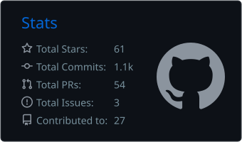
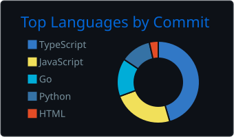
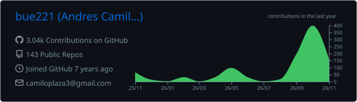

<!-- Header -->
<p align="center">
  
</p>

<p align="center">
  <a href="https://portafolio.bue221.xyz">
    
  </a>
</p>

<p align="center">
  <a href="mailto:camiloplaza3@gmail.com"></a>
  <a href="https://portafolio.bue221.xyz"></a>
  <a href="https://www.linkedin.com/in/bue221/"></a>
  <a href="mailto:camiloplaza3@gmail.com"></a>
  <a href="https://portafolio.bue221.xyz/CV%20Andres%20Plaza%20-%20ES.pdf"></a>
</p>

---

## 👋 About me


I'm a **Full Stack + AI developer** with **4+ years** of experience. Strong frontend craft in **React / Next.js + TypeScript**, plus backend work in **Python and Go**. I build **AI agent platforms**, product UIs and polished interfaces — and outside of code I'm a **tattoo artist** who plays classical guitar. 🎸

```ts
const andres = {
  location: 'Bogotá, Colombia 🇨🇴',
  status: 'Available for work 🟢',
  lastRole: 'Software Engineer AI @ Mercado Libre (Jul 2025 – Sep 2026)',
  education: 'Systems Engineering — Universidad Central',
  focus: ['AI agents', 'Evals & observability', 'Product UIs'],
  hobbies: ['Tattoo 🎨', 'Soccer ⚽', 'Guitar & ukulele 🎸', 'Traveling ✈️'],
  secretIdentity: 'Batman 🦇 (shhh...)',
}
```

<br clear="right" />

## 📈 Impact

<table align="center">
  <tr>
    <td align="center" width="25%"><h2>10k+</h2><sub>daily AI conversations evaluated across 10 agents<br/><b>Mercado Libre</b></sub></td>
    <td align="center" width="25%"><h2>+110%</h2><sub>lead capture with a Python + LangChain chatbot<br/><b>Spot2</b></sub></td>
    <td align="center" width="25%"><h2>−90%</h2><sub>duplicate requests in the map view<br/><b>Spot2</b></sub></td>
    <td align="center" width="25%"><h2>3</h2><sub>junior devs mentored as Frontend Tech Lead<br/><b>Straico</b></sub></td>
  </tr>
</table>

## 🚀 Featured projects

<table>
  <tr>
    <td width="50%" valign="top">
      <a href="https://portafolio.bue221.xyz/portfolio/swarm-chatbot-real-state"></a>
      <h3>🤖 Swarm Chatbot Real Estate</h3>
      <p>OpenAI Swarm multi-agent chatbot for real-estate advising: a triage agent hands off to profiling, FAQ and visit-scheduling specialists.</p>
      <p>
        
        
        
      </p>
      <a href="https://colab.research.google.com/drive/1tOnU-nwp2vjdY166NdD8ID_y6YJFDkO9?usp=sharing"></a>
      <a href="https://github.com/bue221/swarm-chatbot-real-state"></a>
    </td>
    <td width="50%" valign="top">
      <a href="https://portafolio.bue221.xyz/portfolio/redsensurb"></a>
      <h3>📡 RedSensUrb</h3>
      <p>Distributed urban-sensor MVP: Java nodes stream UDP telemetry to a Spring coordinator; critical alerts are committed with 2PC over RMI replicas.</p>
      <p>
        
        
        
        
      </p>
      <a href="https://portafolio.bue221.xyz/portfolio/redsensurb"></a>
      <a href="https://github.com/bue221/RedSensUrb"></a>
    </td>
  </tr>
  <tr>
    <td width="50%" valign="top">
      <a href="https://portafolio.bue221.xyz/portfolio/operia"></a>
      <h3>📊 Operia</h3>
      <p>Business OS for invoicing, inventory, purchases, cash register and team ops in one system — less spreadsheets, more day-to-day control.</p>
      <p>
        
        
      </p>
      <a href="https://operia.bue221.xyz/"></a>
    </td>
    <td width="50%" valign="top">
      <a href="https://portafolio.bue221.xyz/portfolio/scanline-master"></a>
      <h3>🎓 ScanLine Master</h3>
      <p>Educational SPA that teaches polygon scan-line fill with a step-by-step simulator, free-draw lab and KaTeX fundamentals.</p>
      <p>
        
        
        
      </p>
      <a href="https://scanline-master.vercel.app"></a>
      <a href="https://github.com/bue221/scanline-master"></a>
    </td>
  </tr>
  <tr>
    <td width="50%" valign="top">
      <a href="https://portafolio.bue221.xyz/portfolio/wardrobe-app"></a>
      <h3>👕 Wardrobe</h3>
      <p>Mobile-first PWA for a local wardrobe and outfits, with IndexedDB storage and optional on-device AI via WebLLM.</p>
      <p>
        
        
        
      </p>
      <a href="https://wardrobe-app-woad.vercel.app"></a>
      <a href="https://github.com/bue221/wardrobe-app"></a>
    </td>
    <td width="50%" valign="top">
      <a href="https://portafolio.bue221.xyz/portfolio/qr-code-generator"></a>
      <h3>🔳 QR Code Generator</h3>
      <p>Local-first Next.js app that generates customizable QR codes in the browser, with logo, colors and PNG/SVG download.</p>
      <p>
        
        
      </p>
      <a href="https://qr-code-generator.bue221.xyz/"></a>
      <a href="https://github.com/bue221/qr-code-generator"></a>
    </td>
  </tr>
</table>

<p align="center">
  <a href="https://portafolio.bue221.xyz/portfolio"></a>
</p>

## 💼 Experience

| Period | Role | Company | Highlight |
|:--|:--|:--|:--|
| Jul 2025 – Sep 2026 | Software Engineer AI | [Mercado Libre](https://www.mercadolibre.com.co/) | Evals platform classifying 10k+ daily conversations across 10 AI agents, plus Datadog observability |
| 2025 | Frontend Tech Lead | [Straico](https://straico.com/) | Led 3 devs; unified AI models via OpenRouter and fixed realtime-chat CPU usage |
| 2022 – 2025 | Senior Frontend Developer & AI Specialist | [Spot2](https://spot2.mx/) | AI chatbot (+110% leads), −90% duplicate requests, AWS microservices with CI/CD |
| 2021 – 2022 | Frontend Developer | [Imaginamos](https://imaginamos.com/) | Built the Brilla CMS end to end and ETB commercial flows |

<details>
<summary><b>Earlier roles</b></summary>
<br/>

| Period | Role | Company | Highlight |
|:--|:--|:--|:--|
| 2021 | Frontend Developer | [INETUM](https://www.inetum.com/es) | React/Angular features for Claro with Redux Toolkit |
| 2021 | Software Developer | S I G | Admin dashboard with React Admin and Chart.js |
| 2019 – 2021 | Software Developer | BOOKII | Conversational clubs with Redux; Gatsby + Contentful site |

</details>

## 🛠️ Tech stack

<p align="center"><b>Frontend</b></p>
<p align="center">
  
</p>

<p align="center"><b>Backend & data</b></p>
<p align="center">
  
</p>

<p align="center"><b>Cloud & tooling</b></p>
<p align="center">
  
</p>

<p align="center"><b>AI</b></p>
<p align="center">
  
  
  
  
  
  
  
</p>

## 📊 GitHub stats

<p align="center">
  
  
</p>
<p align="center">
  
</p>
<p align="center">
  
</p>

<picture>
  <source media="(prefers-color-scheme: dark)" srcset="https://raw.githubusercontent.com/bue221/bue221/output/snake-dark.svg" />
  <source media="(prefers-color-scheme: light)" srcset="https://raw.githubusercontent.com/bue221/bue221/output/snake-light.svg" />
  
</picture>

## 🤝 Let's work together

<p align="center">
  I'm <b>open to full-time roles, freelance and collaborations</b> — especially around AI agents and product engineering.<br/>
  The fastest way to reach me is by <a href="mailto:camiloplaza3@gmail.com">email</a> or <a href="https://www.linkedin.com/in/bue221/">LinkedIn</a>.
</p>

<p align="center">
  <a href="https://www.instagram.com/caj_ink/"></a>
  <a href="https://www.buymeacoffee.com/bue221"></a>
  
</p>

<p align="center">
  
</p>
